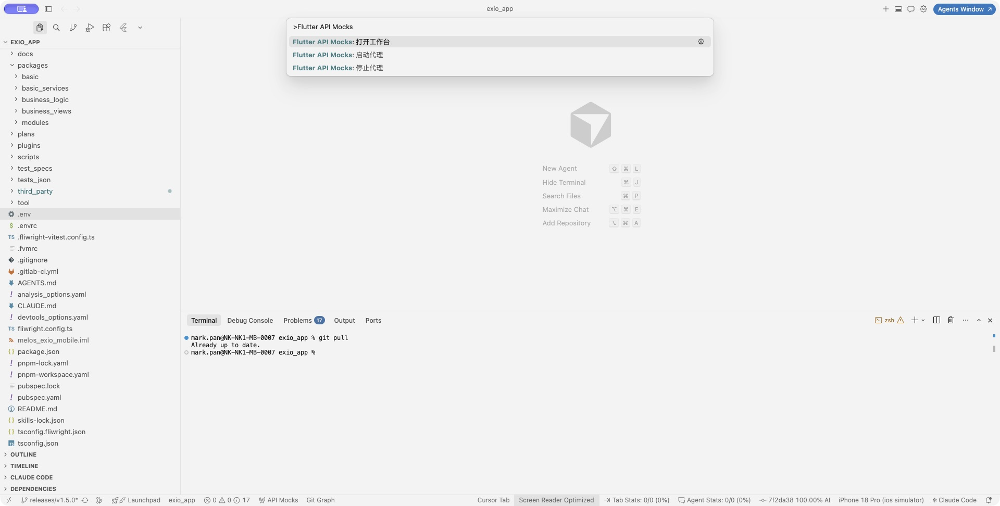
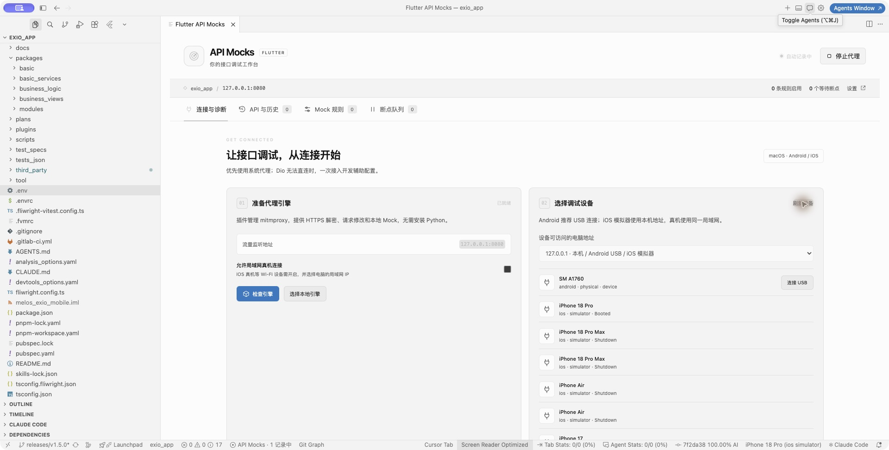
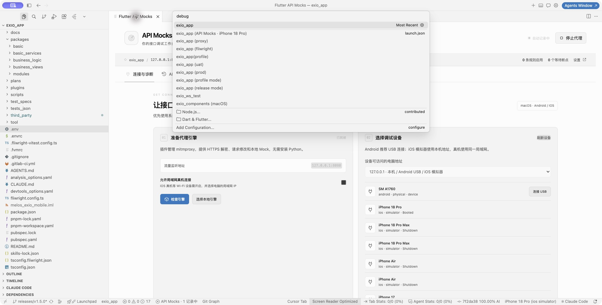
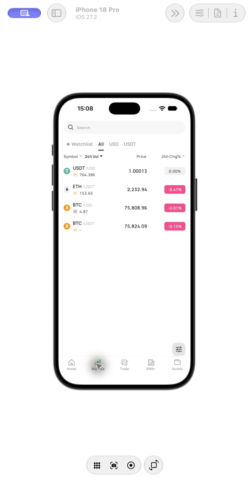
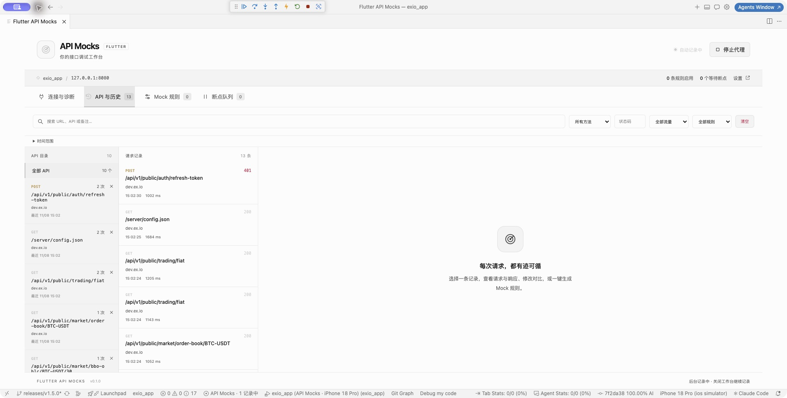
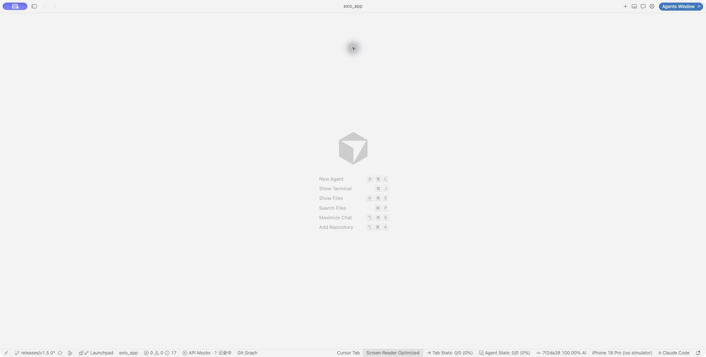
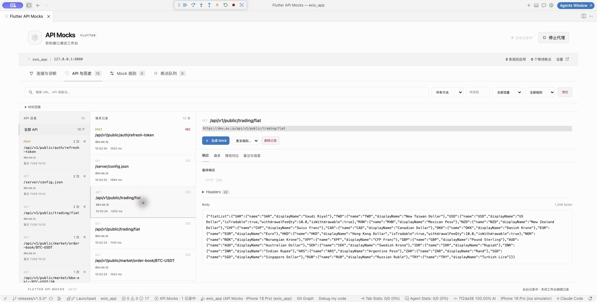
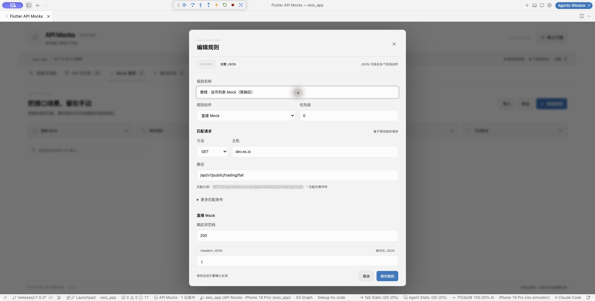
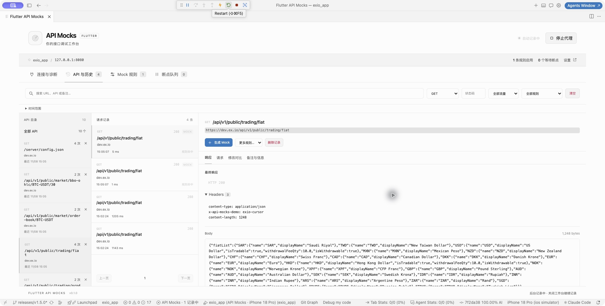
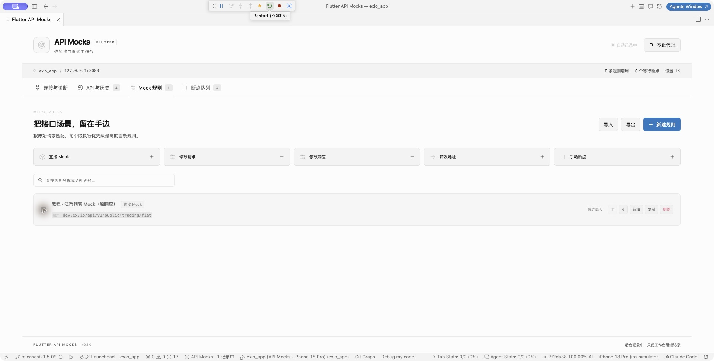

# EXIO：在 Cursor 和 iPhone 18 Pro 使用 API Mocks

本教程截图来自 2026-11-08 的真实操作。项目为 `/Users/mark.pan/Documents/exio/exio_app`，设备为 iPhone 18 Pro / iOS 27.2，使用 dev 环境。插件名称 **Flutter API Mocks**，扩展 ID `api-mocks.flutter-api-mocks`。

截图保留首次接入时的界面。当前 API 工作台已增加目录收起 / 展开、最近调用与请求时间倒序、详情放大，以及正文 JSON / 原文切换和复制，详见 [API 与历史使用说明](../../README.md#api-与历史)。

后续登录诊断发现 MFA 请求在代理链路约 10 秒超时，且 App 将网络错误显示成通用验证失败；该问题尚未闭环，不能把本教程的首页与 Mock 验收视为登录通过。证据和恢复方式见 [问题记录](../../.harness/momory/FAILURES.md)。

## 已配置好的内容

- 代理地址：`127.0.0.1:8080`，仅本机监听；iOS 模拟器无需 adb reverse，也无需打开局域网监听。
- Cursor 的 Flutter SDK 路径已修正为本机安装的 3.47.8。
- 新增启动项 **exio_app (API Mocks · iPhone 18 Pro)**，目标文件 `apps/exio_app/lib/main_api_mocks.dart`。
- 独立入口复用原 App 启动流程，为主 API Dio 加入当前代理 CA 公钥证书，保留 TLS 信任链和主机名校验。仅 Debug + 显式 `API_MOCK_PROXY` 参数启用，不改默认入口或发布配置。
- 当前已记录 10 个 API、39 条请求，多个真实 HTTPS 请求返回 200；从法币列表响应生成的 Mock 已在真实 App 中命中两次。
- 教程规则 **教程 · 法币列表 Mock（原响应）** 已保留，结束时停用。代理继续运行，你可以继续正常操作应用并观察记录。

## 1. 打开插件

在 Cursor 按 **⌘ ⇧ P**，输入 `Flutter API Mocks`，执行 **Flutter API Mocks: 打开工作台**。也可点击底部状态栏的 **API Mocks**。当前版本没有独立左侧栏图标。

## 2. 确认代理与设备

在 **连接与诊断** 查看顶部“自动记录中”和地址 `127.0.0.1:8080`。点击 **刷新设备**，确认 iPhone 18 Pro 为 `Booted`。本机已准备好引擎，后续无需重复安装。

首次在其他机器使用，需要先安装引擎，并针对那台机器重新完成证书接入。端口若变化，启动项的 `API_MOCK_PROXY` 也要同步修改。

## 3. 运行应用

按 **⌘ ⇧ P**，执行 **Debug: Select and Start Debugging**，选择 **exio_app (API Mocks · iPhone 18 Pro)**。

以后也可在“运行和调试”下拉框选择这个启动项，然后按 **F5**。该配置包含 dev flavor、`EXIO_ENV=dev`、原有开发环境配置文件和 `API_MOCK_PROXY=127.0.0.1:8080`。

应用已实际运行到 iPhone 18 Pro，首页及行情页面均可展示：

## 4. 看自动发现的 API 和历史

在应用中浏览页面，再切到插件的 **API 与历史**：

- 左侧：持久 API 目录，按方法、主机和路径归类，显示累计调用次数和最近调用时间。
- 中间：具体请求，显示状态码、耗时、Mock 标记和规则命中。
- 右侧：选中请求的响应、请求、修改对比及备注。

不用创建规则就能记录。关闭工作台标签页后继续记录，下次打开会显示期间产生的请求。清空请求历史不会清空左侧目录；目录删除按钮只删除目录项，再次调用会重新发现。

本次已重载 Cursor 实测：未打开工作台时，底部即显示 **API Mocks · 1 记录中**。EXIO 这类根 pubspec 只有 workspace 声明的多包仓库也可自动识别。

## 5. 从历史生成 Mock

选择一个成功的公开查询请求，例如 `GET /api/v1/public/trading/fiat`，点击右侧 **生成 Mock**。表单会带入匹配条件及真实响应。

本次演示保留原 JSON 数据，规则名为 **教程 · 法币列表 Mock（原响应）**。你可以编辑响应状态码、Headers JSON、Body，勾选 **保存后启用**，点击 **保存规则**。

匹配主机填 `dev.ex.io`，路径填 `/api/v1/public/trading/fiat`，方法为 `GET`；主机中不填 `https://`。本次响应头仅保留 JSON 内容类型，并加入可辨识的 `x-api-mocks-demo: exio-cursor`。

这是直接本地返回，命中时不会请求上游。规则编辑器可向下滚动，正文在 Headers 下方。

## 6. 确认规则命中

让应用重新调用接口。若页面缓存未再次发请求，可使用 Cursor 调试工具栏的 **Restart / Hot Restart** 热重启应用。修改编译期参数则需要停止后重新运行，热重启不更新 dart-define。

本次热重启后，法币接口出现两条 **200 + MOCK + 规则命中** 记录，响应头有 `x-api-mocks-demo: exio-cursor`，耗时分别约 1 ms 和 5 ms：

## 7. 开关规则与其他能力

切到 **Mock 规则**，左侧开关控制启停。当前教程规则已停用，后续请求恢复访问上游；已采集历史保留当时的事实。

同一页面提供以下模板：

| 模板 | 用法 |
| --- | --- |
| 直接 Mock | 配置状态码、响应头、JSON 或文本正文，直接本地返回 |
| 修改请求 | 修改方法、URL、查询参数、请求头及 JSON / 文本正文 |
| 修改响应 | 保留上游请求，修改响应状态码、头部或正文 |
| 转发地址 | 填入目标完整 URL，代理改写目标并转发；不会返回额外 301/302 |
| 手动断点 | 请求前或响应后暂停，进入断点队列编辑、放行或终止 |

也可以在历史详情的“更多规则…”中直接生成对应草稿。每阶段执行优先级最高的首条匹配规则；相同优先级按列表顺序。

手动断点只在工作台打开时交互，关闭工作台会释放等待中的断点。App 自身 HTTP 超时可能短于断点等待时间，例如 EXIO 默认约 10 秒，应及时放行。

## 8. 停止和恢复常规开发

- 保持代理运行时，可继续使用 API Mocks 启动项；关闭工作台不停止采集。
- 要关闭代理，先停止当前调试，再选择原来的 **exio_app** 启动项运行，最后点击插件 **停止代理**，避免应用仍指向已关闭的代理。
- 停用自动后台启动可设置 `flutterApiMocks.autoStart: false`。手动停止后，重新打开工作台不会擅自启动。
- 独立开发入口内的 CA 属于本机配置；换电脑或重建插件 CA 后需要更新，不能复制私钥。

## 实际验证边界

本次验证主 API Dio 的 HTTPS 记录和本地 Mock，没有进行登录、交易或资产操作；原有登录恢复请求返回 401，首轮部分请求超时后重试，并不代表全部后端接口均健康。App 下载临时 Dio、原生插件、WebView 和 WebSocket 不在本次采集覆盖承诺中。

业务项目仅保留本地接入改动，没有自动提交。教程截图不包含 CA 私钥或认证请求正文。
