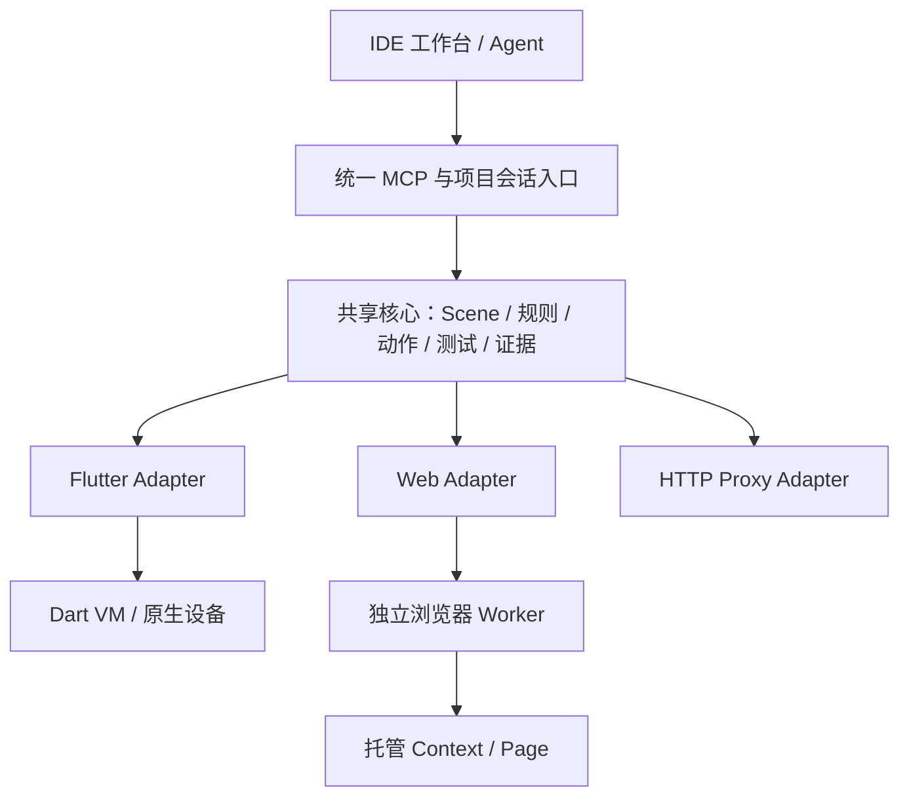

# 架构决策：单入口与独立运行时

决策日期：2026-11-16；基线 v1。以下是实施约束，具体类型与工具 schema 在所属 phase 中实现并验证。

## 产品与交付边界

继续维护一个仓库、一个插件、默认一个 MCP 服务。保留 `flutter-pilot.flutter-pilot`、`flutter-pilot` 及 `.flutter-pilot/` 的兼容身份。当前不更名、不新建 Web 产品，也不复制一套 Scene 或 MCP 网络服务。

以后只有独立团队/发布节奏、脱离 IDE 的产品需求或已证实的依赖成本需要拆分时再评估多交付包；优先共享核心，而不是复制仓库。本路线图不包含第二个 MCP profile 或第二个服务的实现。

## 方案取舍

以下是针对本仓库的设计判断，实际启动、内存和包体成本由 phase-07 测量，不预设性能结论。

| 维度       | 一个插件 / 一个 MCP，内部适配                          | 一个插件 / 两个 MCP                              | Web 独立插件 / 项目                            |
| ---------- | ------------------------------------------------------ | ------------------------------------------------ | ---------------------------------------------- |
| 用户配置   | 复用现有安装和服务入口，调用时明确目标                 | 需解释两个入口及各自目标，处理重名工具和重复配置 | 可分别安装，但跨端用户需维护两套产品配置       |
| 代码与维护 | 共享规则、Scene、证据和协议测试；需要先抽出运行时边界  | 仍须共享核心，否则修复易分叉；多一套服务生命周期 | 独立迭代容易，核心和文档复制则增加长期维护成本 |
| Agent 使用 | 同一入口发现目标，靠明确身份与能力路由消除歧义         | 工具范围可分别提供，但跨端查找和协同更复杂       | 单端工具集中；跨端流程需要协调不同插件         |
| 依赖与故障 | 私有按需依赖＋独立 Worker 隔离浏览器；共享核心仍需回归 | 拆服务可隔离进程，但不能自动消除共享扩展宿主风险 | 可独立分发和回滚，需另建兼容和跨端版本策略     |
| 发布与团队 | 适合当前共用工作台、存储和维护流程                     | 适合已出现不同服务部署或权限需求时重新评估       | 适合独立团队、独立用户群及明确独立产品边界     |

当前主要差异在运行时和 UI 目标，Scene、网络规则、测试证据及 IDE 工作台仍可复用，因此先采用第一种方案。不要用第二个 MCP 代替内部状态隔离。若未来 Web 必须脱离 IDE 独立运行，或实测按需依赖仍造成不可接受的 Flutter 使用成本，再根据记录的指标评估拆包；保留共享核心接口，避免重建两套数据格式。

## 模块职责

- 共享核心负责定义装配、能力校验、固定目标、执行锁、结果及脱敏，不导入 Dart VM 类型或浏览器对象。
- Flutter Adapter 包装当前 VM、Dio、设备行为；第一阶段以行为兼容为目标，避免同时改动 VM 注入模板。
- HTTP Proxy Adapter 包装 Python 引擎、规则同步、历史和采集状态；MCP 与工作台使用同一个来源路由。
- Web Adapter 负责能力与目标分派，浏览器客户端、进程和事件处理放独立 Worker；IPC 必须带请求、目标和运行时代次。
- Scene/Workflow/Test 控制器只通过所需的窄接口使用网络或 UI 能力，不要求每种运行时实现全部能力。
- 浏览器依赖在显式准备时安装到插件私有目录；版本和安装清单可核查。打开工作区、读取 Prompt 或查询状态不下载依赖、不启动浏览器。

## 目标身份与状态隔离

区分项目身份、运行时身份和 UI 页面身份：

- 项目：已有 projectId 加工作区实际路径，用于配置、Scene 库和本机存储隔离。
- 运行时：明确 Flutter / 浏览器 / 代理目标及代次；同一工作区允许多个运行时，不能通过全局模式字段同时控制所有目标。
- 浏览器：Context 与 Page 在本次连接内拥有明确身份；断线、页面关闭及进程重启使旧身份失效。
- 调用：保留旧 Flutter `sessionId` 调用兼容；新增明确目标字段或运行时会话形式。多候选不能静默取第一个、最近页面或焦点页。
- 网络：代理请求只有经其监听端口的来源保证，没有天然 DOM page 身份。独立代理实例归属明确项目/运行时；归属不明的手工流量不得计入页面业务测试。

共享持久 Scene 定义；运行时激活状态、历史、临时 scenario 状态、观察窗口和锁分别拥有明确作用域。一个运行的快照必须覆盖动作依赖、Mock 和临时覆盖；跨运行时不共享可变执行状态。

锁覆盖实际共享资源：Flutter 设备沿用设备租约，浏览器默认在 Context 级串行修改和运行，独立 Context 可以并行。共享同一个 Context 的页面不能绕过锁改变它的网络规则。保持旧激活记录的兼容迁移；无法证明归属时不自动在新增目标激活。

## 网络后端

phase-02 用现有代理先交付手动 Web HTTP Mock。phase-03 增加托管浏览器的直接拦截，由明确网络后端选择决定请求路径；不在同一个请求上同时执行代理和浏览器规则。

浏览器监听和规则必须先于初始页面导航安装；未覆盖的附着前请求不能计入已覆盖范围。托管 Context 明确采用 Service Worker 阻止策略，并说明缓存/路由差异。HTTPS 代理验收使用真实受信任 CA，不以忽略证书错误或关闭 Web 安全替代。

匹配、优先级、原始/有效请求响应、mocked 和 ruleId 的业务语义跨后端保持一致；不支持的请求改写或正文类型应拒绝或带限制直通，不得返回成功却静默忽略。

## MCP 与选择器

- 网络、Scene、动作和测试工具优先复用。浏览器准备、Context/Page 管理、导航和刷新使用必要的专用工具；Flutter 热重载和设备操作保留专用语义。
- 能力按运行目标声明 supported、原因及覆盖边界。工具公开列表不随焦点或一次运行时选择悄悄变化；对不支持目标的调用在副作用前拒绝。
- Flutter Key 与 Web DOM locator 使用可区分 schema；Web role/name 作为一个显式选择器，不是 testId 缺失时的自动回退。
- 读取离线指南、Prompts 和 schema 不依赖在线运行时；新增能力同一阶段同步所有发现入口与协议测试，不拖到最后集中补说明。

## 故障、取消与兼容

浏览器 Worker 退出后只作废对应运行时和正在执行的动作；不关闭 Flutter 会话或它的采集。迟到 IPC 结果不能复活旧目标。取消后查询实际业务与清理结果，不重放提交或消息；停止自己创建的 Worker/Context，保留用户进程和数据。

现有 Scene v2 存储仍是唯一来源。新增 Web selector 必须用生产 schema 校验，旧 Key actions 展开结果保持一致。HTTP 规则可跨端复用，UI actions 不强制跨端通用；Web 不支持的键盘/设备动作在预检阶段给出具体原因。
